
<b>Français</b> · <a href="README.md">English</a>

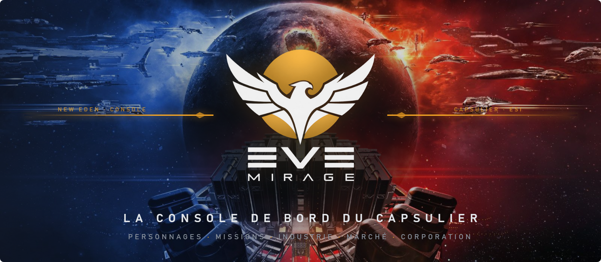

&nbsp;

EveMirage rassemble ce dont un pilote d'EVE Online a besoin au quotidien : les plans de compétences de tous ses personnages, les missions, le minage, l'industrie, le marché et la vie de la corporation. Une seule fenêtre, reliée à l'ESI, qui garde tout sur ton PC.

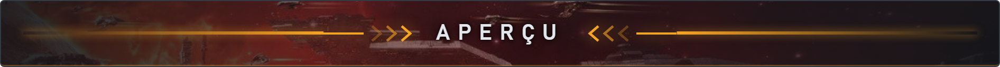

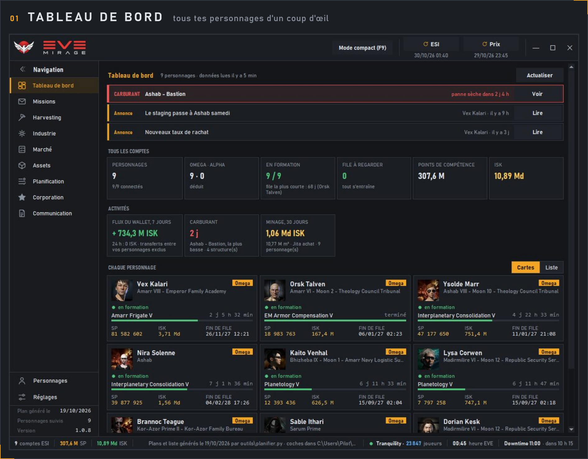

Formation en cours, fin de file, points de compétence, ISK, statut Omega, carburant et annonces de la corporation, pour <strong>tous tes personnages</strong> à la fois.

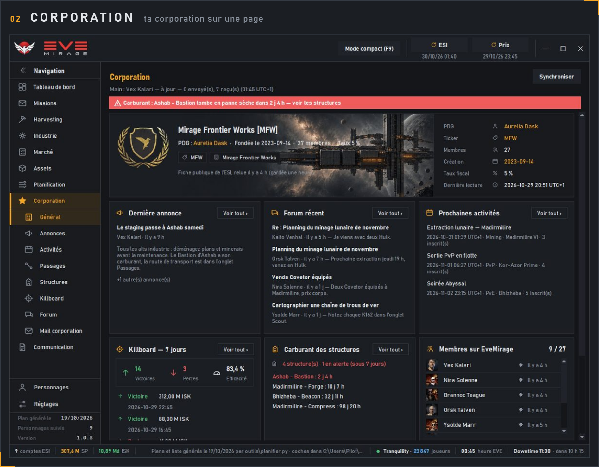

Membres en ligne, annonces, forum, activités à venir et <strong>killboard</strong>, partagés par le service de corporation.

<table>
<tr>
<td width="50%" valign="top">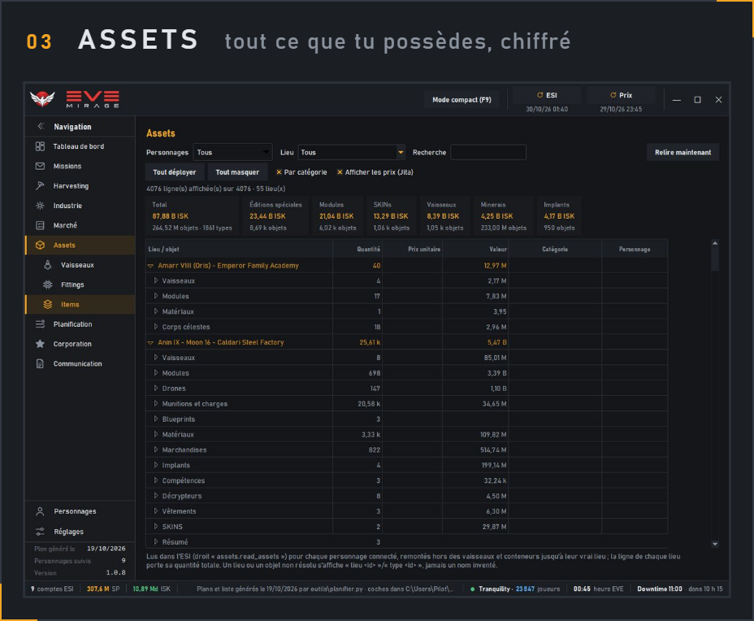 
Par lieu et par catégorie, au prix de Jita, pour un, plusieurs ou tous les personnages.</td>
<td width="50%" valign="top">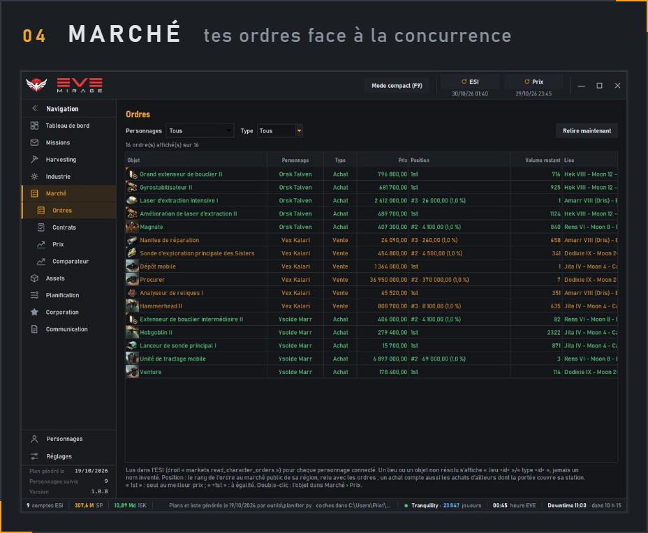 
Ordres d'achat et de vente dans chaque station, ton <strong>rang</strong> et l'écart au meilleur prix.</td>
</tr>
<tr>
<td width="50%" valign="top">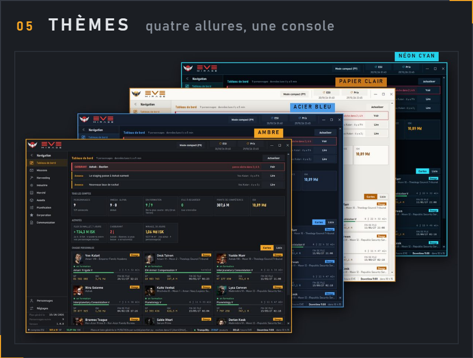 
Ambre, Acier bleu, Néon cyan et Papier clair : on change à tout moment depuis le menu Thème.</td>
<td width="50%" valign="top">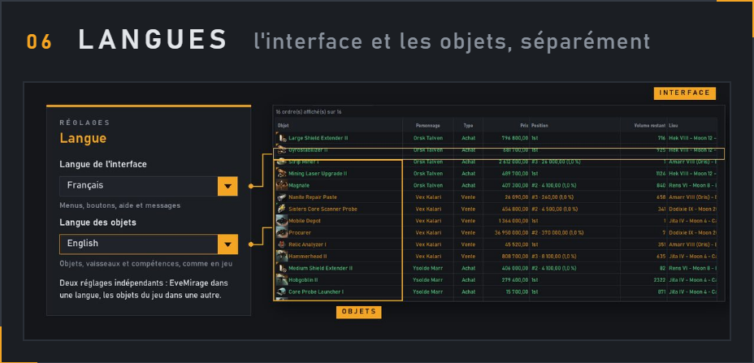 
EveMirage dans une langue, les objets du jeu dans une autre : <strong>deux réglages indépendants</strong>.</td>
</tr>
</table>

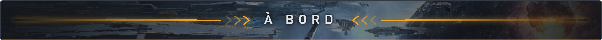

<table>
<tr>
<td width="50%" valign="top"><h3>Planification</h3>
<ul>
<li>Plans de compétences optimisés, par objectif et par spécialisation</li>
<li>Remaps : quand, lesquels, et ce qu'ils font gagner</li>
<li>Éditeur de plan : niveaux, priorités, glisser-déposer, annuler</li>
<li>Navigateur de compétences</li>
<li>Optimiseur d'attributs, avec 0, 1, 2… remaps</li>
<li>Livres à acheter et route d'achat</li>
<li>Import et export EVEMon / EveLens</li>
</ul></td>
<td width="50%" valign="top"><h3>Missions</h3>
<ul>
<li>Missions PvE : variantes, ennemis, alertes de réputation</li>
<li>Agents à distance et corporations</li>
<li>Standings et leur journal</li>
<li>Epic Arc</li>
<li>« Que faire ? » : la suite conseillée</li>
</ul></td>
</tr>
<tr>
<td width="50%" valign="top"><h3>Harvesting</h3>
<ul>
<li>Mining : tableau, journal, lunes, raffinage</li>
<li>Planetary Interaction : colonies et extracteurs</li>
<li>Scout</li>
</ul></td>
<td width="50%" valign="top"><h3>Industrie</h3>
<ul>
<li>Blueprints, jobs en cours</li>
<li>Production et recherche</li>
</ul></td>
</tr>
<tr>
<td width="50%" valign="top"><h3>Marché et Assets</h3>
<ul>
<li>Ordres, contrats, prix, comparateur</li>
<li>Items, vaisseaux, fittings</li>
</ul></td>
<td width="50%" valign="top"><h3>Corporation</h3>
<ul>
<li>Fiche générale, activités, passages</li>
<li>Structures et leur carburant</li>
<li>Killboard</li>
<li>Annonces, forum et mémos de la corporation</li>
</ul></td>
</tr>
<tr>
<td width="50%" valign="top"><h3>Communication</h3>
<ul>
<li>Mail EVE, lu et écrit depuis EveMirage</li>
</ul></td>
<td width="50%" valign="top"><h3>Au quotidien</h3>
<ul>
<li>Quatre thèmes</li>
<li>Langue de l'interface et langue des objets, au choix, séparément</li>
<li>Mode compact (F9), notifications Windows</li>
<li>Mise à jour automatique, signée</li>
<li>Connexion ESI officielle ; tes données restent sur ton PC</li>
</ul></td>
</tr>
</table>

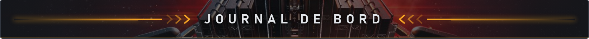

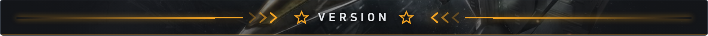

<strong>1.0.8</strong> — 30 octobre 2026

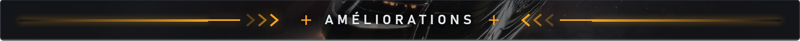

<ul>
<li>Choix du personnage dans chaque page qui en a besoin ; un, plusieurs ou tous au marché</li>
<li>Améliorations visuelles</li>
</ul>

Les 5 versions précédentes

<strong>1.0.7</strong> — 29 octobre 2026

<ul>
<li>Nouveau pied d'informations : comptes ESI, SP, ISK, serveur et heure EVE</li>
<li>Améliorations visuelles</li>
</ul>

<strong>1.0.6</strong> — 29 octobre 2026

<ul>
<li>Améliorations visuelles</li>
<li>Amélioration de l'installateur</li>
</ul>

<strong>1.0.5</strong> — 29 octobre 2026

<ul>
<li>La mise à jour se propose dans une fenêtre</li>
<li>Amélioration de l'installateur</li>
</ul>

<strong>1.0.4</strong> — 29 octobre 2026

<ul>
<li>Corrections visuelles et de traduction</li>
<li>Amélioration de l'installateur</li>
</ul>

<strong>1.0.3</strong> — 29 octobre 2026

<ul>
<li>Correction de la mise à jour automatique</li>
</ul>

<table>
<tr>
<td width="33%" valign="top"><h3>Installer</h3>Télécharge l'<a href="https://github.com/myrmoon/evemirage-releases/releases/latest/download/EveMirage-Setup.exe">installateur</a>, lance-le, puis connecte un personnage. Windows 10 ou 11.</td>
<td width="33%" valign="top"><h3>Tes données</h3>Tout reste sur ton PC. La connexion passe par le site officiel de CCP ; EveMirage ne voit jamais ton mot de passe.</td>
<td width="33%" valign="top"><h3>Un souci ?</h3>Ouvre une <a href="https://github.com/myrmoon/evemirage-releases/issues">issue</a> sur ce dépôt.</td>
</tr>
</table>

This material is used with limited permission of CCP Games. No official affiliation or endorsement by CCP Games is stated or implied. © 2014 CCP hf. All rights reserved. "EVE", "EVE Online", "CCP", and all related logos and images are trademarks or registered trademarks of CCP hf.

