
<b>Français</b> · <a href="README.md">English</a>

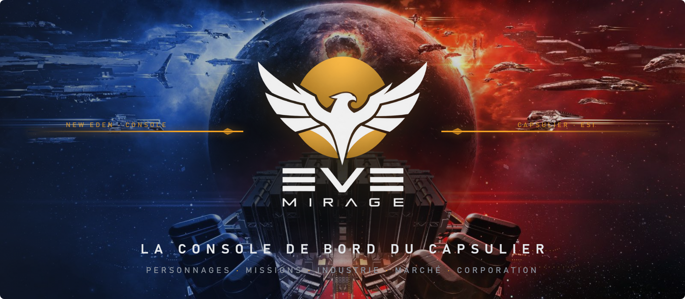

&nbsp;
<a href="#release-log">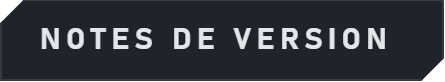</a>

EveMirage rassemble ce dont un pilote d'EVE Online a besoin au quotidien : les plans de compétences de tous ses personnages, les missions, le minage, l'industrie, le marché et la vie de la corporation. Une seule fenêtre, reliée à l'ESI, qui garde tout sur ton PC.

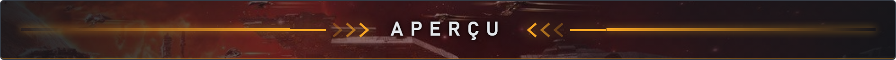

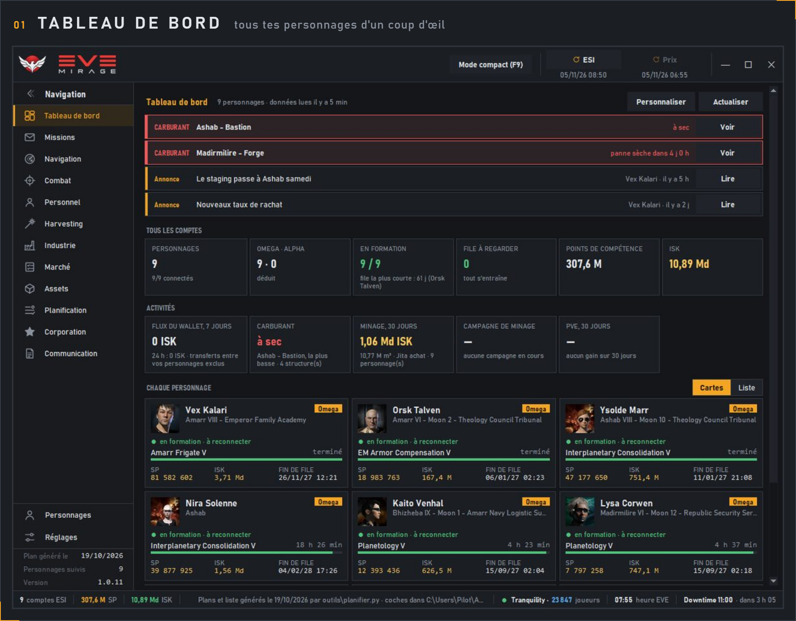

Formation en cours, fin de file, points de compétence, ISK, statut Omega, carburant et annonces de la corporation, pour <strong>tous tes personnages</strong> à la fois.

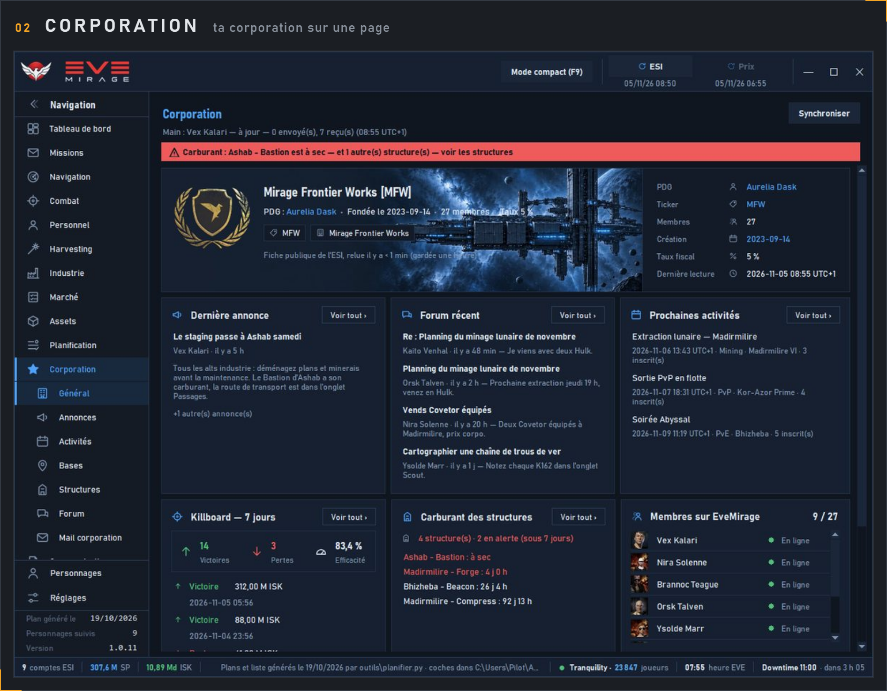

Membres en ligne, annonces, forum, activités à venir et <strong>killboard</strong>, partagés par le service de corporation.

<table>
<tr>
<td width="50%" valign="top">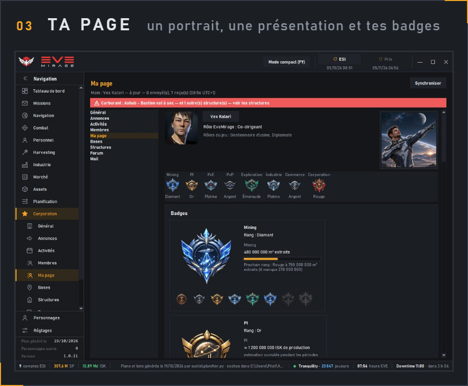 
Chaque membre a sa page : portrait, rôles du jeu, quelques mots sur lui et huit <strong>badges</strong>, de Bronze à Violet, gagnés au minage, à l'interaction planétaire, en PvE, en PvP, en exploration, en industrie, au commerce et dans la vie de la corporation.</td>
<td width="50%" valign="top">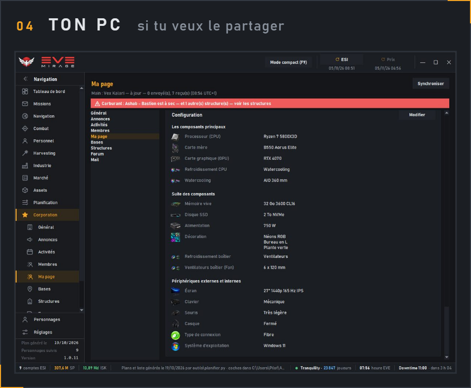 
Remplis le formulaire de la communauté (processeur, carte graphique, écran, périphériques…) et ta corporation voit ta <strong>configuration</strong> sur ta page. Tu choisis ce que tu partages.</td>
</tr>
<tr>
<td width="50%" valign="top">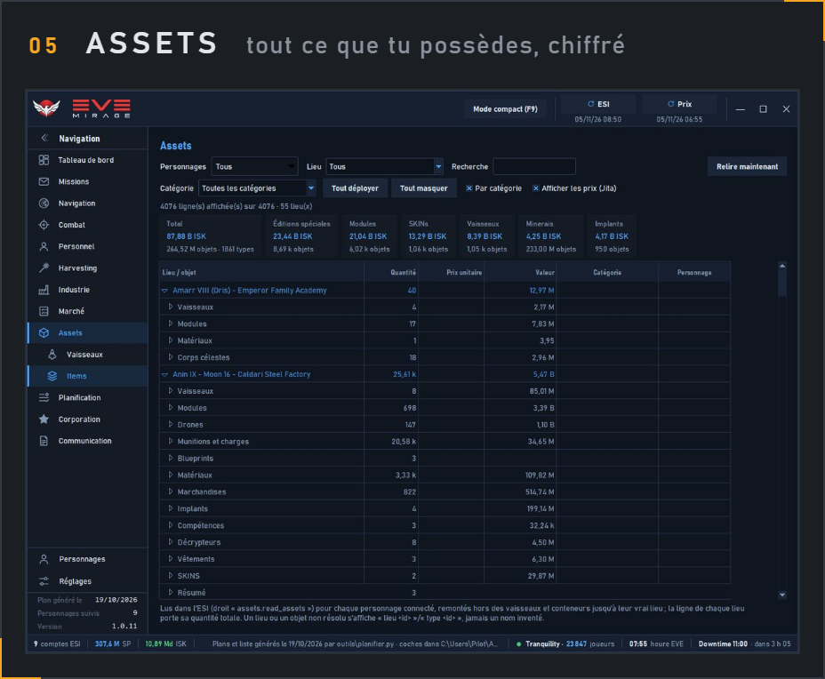 
Par lieu et par catégorie, au prix de Jita, pour un, plusieurs ou tous les personnages.</td>
<td width="50%" valign="top">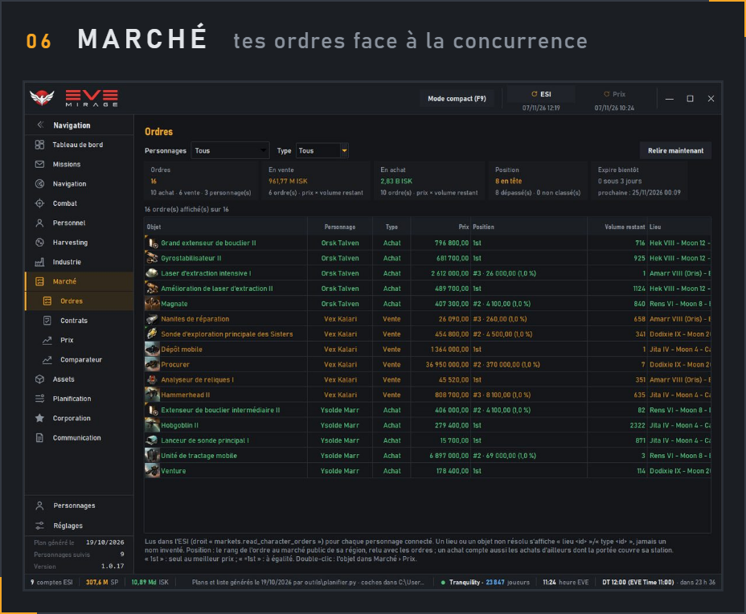 
Ordres d'achat et de vente dans chaque station, ton <strong>rang</strong> et l'écart au meilleur prix.</td>
</tr>
<tr>
<td width="50%" valign="top">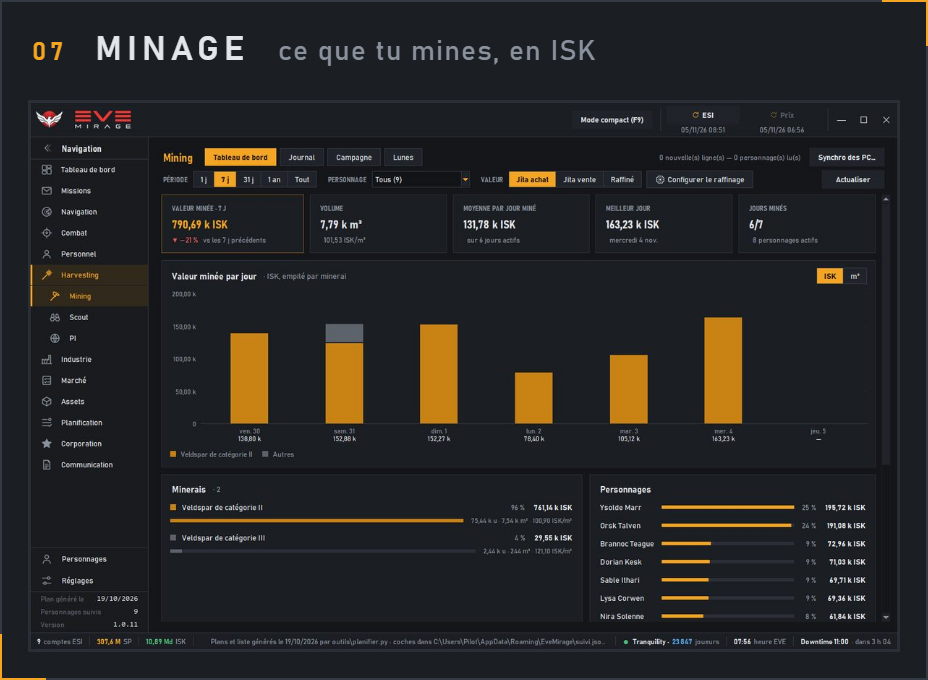 
Valeur minée par jour, par minerai et par personnage, au prix d'achat de Jita, de vente de Jita ou raffiné, avec le journal, les campagnes et les lunes à un onglet de là.</td>
<td width="50%" valign="top">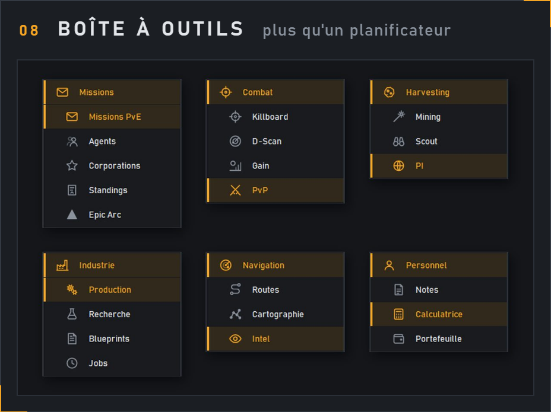 
Un multi-outil pour tout le jeu : <strong>D-Scan, killboard, Scout, interaction planétaire, routes et cartographie, Intel, jobs d'industrie, standings, Epic Arcs, notes, calculatrice et portefeuille</strong>. Le détail est plus bas.</td>
</tr>
<tr>
<td width="50%" valign="top">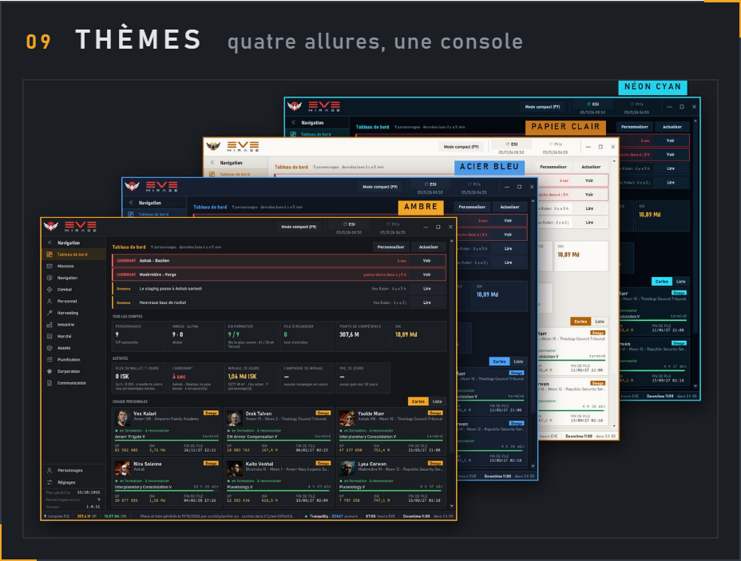 
Ambre, Acier bleu, Néon cyan et Papier clair : on change à tout moment depuis le menu Thème.</td>
<td width="50%" valign="top">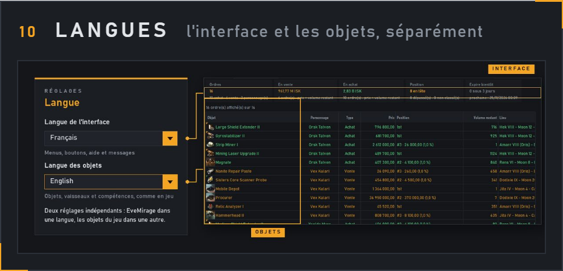 
EveMirage dans une langue, les objets du jeu dans une autre : <strong>deux réglages indépendants</strong>.</td>
</tr>
</table>

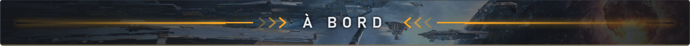

<table>
<tr>
<td width="50%" valign="top"><h3>Planification</h3>
<ul>
<li>Plans de compétences optimisés, par objectif et par spécialisation</li>
<li>Remaps : quand, lesquels, et ce qu'ils font gagner</li>
<li>Éditeur de plan : niveaux, priorités, glisser-déposer, annuler</li>
<li>Navigateur de compétences</li>
<li>Optimiseur d'attributs, avec 0, 1, 2… remaps</li>
<li>Livres à acheter et route d'achat</li>
<li>Import et export EVEMon / EveLens</li>
</ul></td>
<td width="50%" valign="top"><h3>Missions</h3>
<ul>
<li>Missions PvE : variantes, ennemis, alertes de réputation</li>
<li>Agents à distance et corporations</li>
<li>Standings et leur journal</li>
<li>Epic Arc</li>
<li>« Que faire ? » : la suite conseillée</li>
</ul></td>
</tr>
<tr>
<td width="50%" valign="top"><h3>Harvesting</h3>
<ul>
<li>Mining : tableau, journal, lunes, raffinage</li>
<li>Planetary Interaction : colonies et extracteurs</li>
<li>Scout</li>
</ul></td>
<td width="50%" valign="top"><h3>Industrie</h3>
<ul>
<li>Blueprints, jobs en cours</li>
<li>Production et recherche</li>
</ul></td>
</tr>
<tr>
<td width="50%" valign="top"><h3>Marché et Assets</h3>
<ul>
<li>Ordres, contrats, prix, comparateur</li>
<li>Items, vaisseaux, fittings</li>
</ul></td>
<td width="50%" valign="top"><h3>Corporation</h3>
<ul>
<li>Fiche générale, activités, passages</li>
<li>Structures et leur carburant</li>
<li>Killboard</li>
<li>Annonces, forum et mémos de la corporation</li>
</ul></td>
</tr>
<tr>
<td width="50%" valign="top"><h3>Communication et outils</h3>
<ul>
<li>Mail EVE, lu et écrit depuis EveMirage</li>
<li>D-Scan, routes, cartographie, Intel</li>
<li>Notes, calculatrice, portefeuille</li>
</ul></td>
<td width="50%" valign="top"><h3>Au quotidien</h3>
<ul>
<li>Quatre thèmes</li>
<li>Langue de l'interface et langue des objets, au choix, séparément</li>
<li>Mode compact (F9), notifications Windows</li>
<li>Mise à jour automatique, signée</li>
<li>Connexion ESI officielle ; tes données restent sur ton PC</li>
</ul></td>
</tr>
</table>

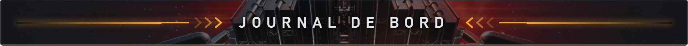

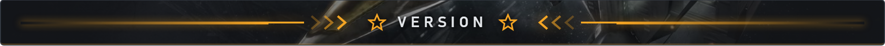

<strong>1.1.4</strong> — 9 novembre 2026

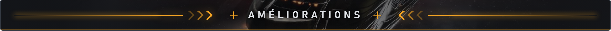

<ul>
<li>**Synchro des PC** : le portefeuille, les réputations et le minage de tous tes PC se rejoignent par un dossier Google Drive, OneDrive ou Dropbox, réglé en un clic dans Réglages ; tes jetons ne voyagent jamais.</li>
<li>**Tableau de bord** : la période des activités propose aussi 1 an, et la carte Standings rassemble chaque standing de tous tes personnages avec le net total, hausses en vert et baisses en rouge.</li>
<li>**Améliorations visuelles** sur le tableau de bord.</li>
</ul>

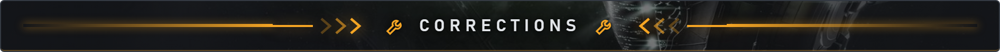

<ul>
<li>**Sécurité** : la mise à jour est vérifiée plus strictement avant de se lancer, et la synchro, les webhooks Discord, le forum et le journal d'erreurs sont durcis.</li>
<li>**Missions** : la fiche « Activité illégale » annonce la vraie perte de standing, et la liste compacte se lit en entier.</li>
<li>**Performances** : les écrans s'ouvrent plus vite (Industrie › Blueprints notamment) et changer de thème est bien plus rapide.</li>
</ul>

Les 5 versions précédentes

<strong>1.1.3b</strong> — 8 novembre 2026

<ul>
<li>Badge Ω / α des personnages plus grand et plus lisible</li>
<li>Le menu de gauche défile quand un groupe s'ouvre dans une fenêtre basse : plus de rubriques coupées</li>
</ul>

<strong>1.1.3</strong> — 8 novembre 2026

<ul>
<li>Standings en tableau façon bourse : les factions et corporations favorites qui ont bougé, avec leur variation sur 24 h, 3 j, 7 j ou 1 m</li>
<li>Accélérateurs et cartes des personnages plus lisibles (Ω et α)</li>
<li>Lancement plus rapide, prix relus en fond avec leur avancement près du bouton Prix</li>
<li>Choix d'un personnage sans suivi, « Redémarrer » depuis la zone de notification, saisie plus fluide dans Missions PvE</li>
</ul>

<strong>1.1.2</strong> — 8 novembre 2026

<ul>
<li>Tableau de bord : choix de la période 1 j / 7 j / 30 j pour toutes les activités (gardé au relancement)</li>
<li>Tableau de bord : nouvelle carte Standings, hausses et baisses façon bourse</li>
<li>Les prix se relisent en fond au lancement, avec un indicateur au pied de la fenêtre</li>
<li>Lancement et tableau de bord plus rapides</li>
<li>Corporations favorites : les valeurs de standings s'affichent dès l'ouverture, sans attente</li>
</ul>

<strong>1.1.1</strong> — 7 novembre 2026

<ul>
<li>Chargements plus rapides quand on a beaucoup de personnages : leurs lectures se font désormais en même temps</li>
<li>Missions PvE : on peut écrire dans « Filtrer » dès l'arrivée sur la page</li>
</ul>

<strong>1.1.0</strong> — 7 novembre 2026

<ul>
<li>Planification : les durées de formation (plans, remaps, navigateur de compétences) tiennent compte de l'accélérateur cérébral actif, et de Biology au moment où il a été lancé</li>
<li>Personnages : « Seulement… » garde un seul personnage, ou les reprend tous, d'un geste dans les listes à personnages</li>
<li>Corporation : signaler une absence (vacances, maladie…) sur le calendrier des activités</li>
<li>Améliorations visuelles</li>
<li>La fenêtre de mise à jour passe devant toute lecture : « Installer maintenant » répond</li>
</ul>

<table>
<tr>
<td width="33%" valign="top"><h3>Installer</h3>Télécharge l'<a href="https://github.com/myrmoon/evemirage-releases/releases/latest/download/EveMirage-Setup.exe">installateur</a>, lance-le, puis connecte un personnage. Windows 10 ou 11.</td>
<td width="33%" valign="top"><h3>Tes données</h3>Tout reste sur ton PC. La connexion passe par le site officiel de CCP ; EveMirage ne voit jamais ton mot de passe.</td>
<td width="33%" valign="top"><h3>Un souci ?</h3>Ouvre une <a href="https://github.com/myrmoon/evemirage-releases/issues">issue</a> sur ce dépôt.</td>
</tr>
</table>

This material is used with limited permission of CCP Games. No official affiliation or endorsement by CCP Games is stated or implied. © 2014 CCP hf. All rights reserved. "EVE", "EVE Online", "CCP", and all related logos and images are trademarks or registered trademarks of CCP hf.

