
<b>English</b> · <a href="README.fr.md">Français</a>

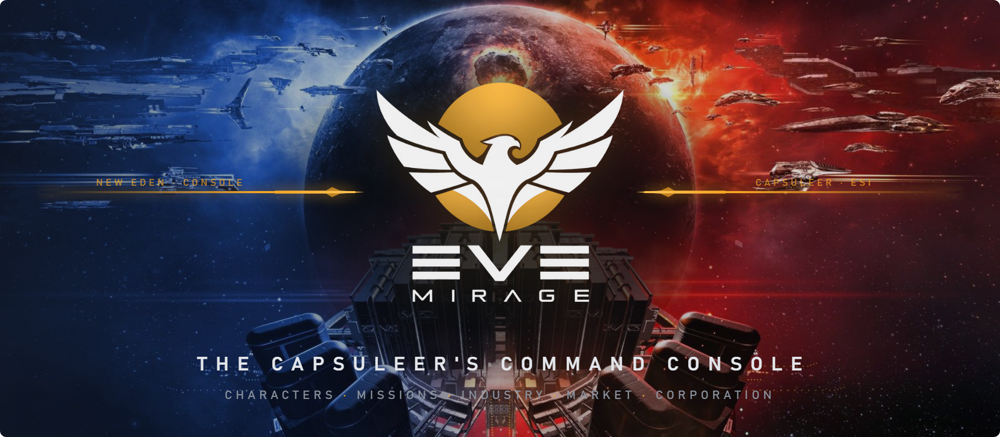

&nbsp;

EveMirage gathers what an EVE Online pilot needs every day: skill plans for all your characters, missions, mining, industry, the market and your corporation's life. One window, connected to ESI, that keeps everything on your PC.

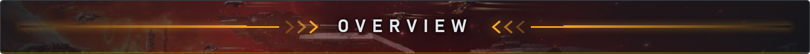

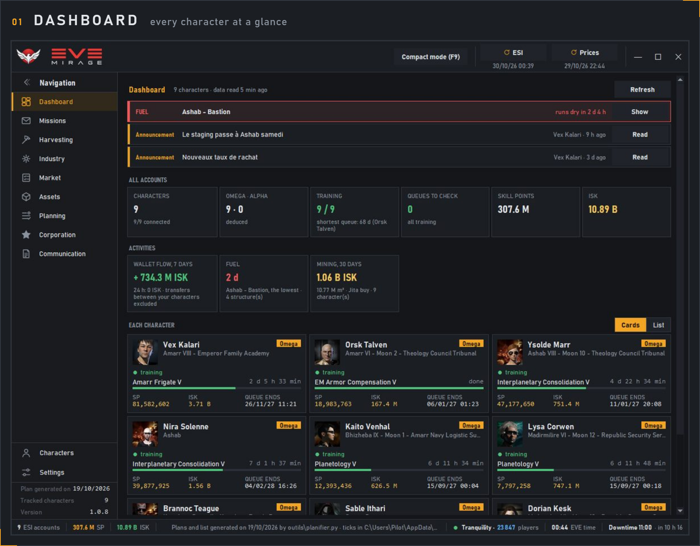

Training in progress, queue end, skill points, ISK, Omega status, fuel and corporation announcements, for <strong>all your characters</strong> at once.

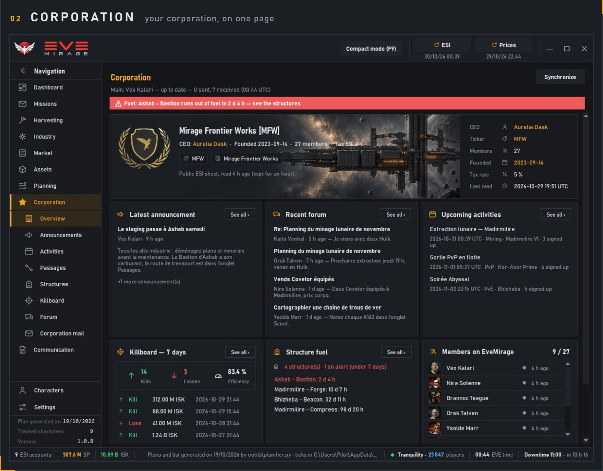

Members online, announcements, forum, upcoming activities and the <strong>killboard</strong>, shared through the corporation service.

<table>
<tr>
<td width="50%" valign="top">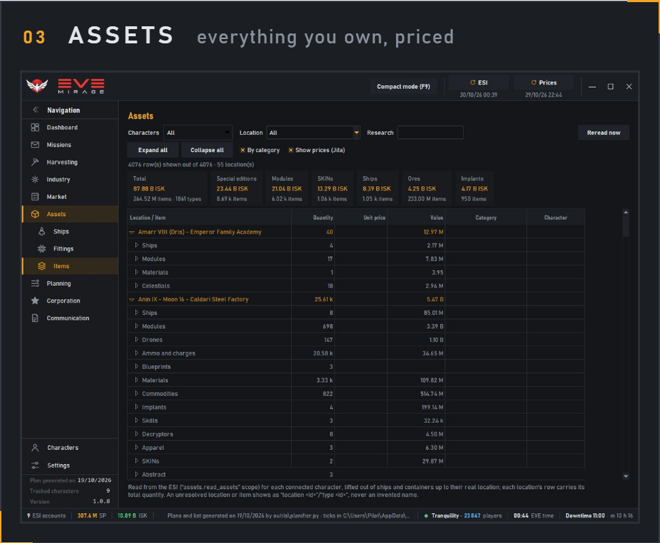 
By location and category, at Jita prices, for one character or all.</td>
<td width="50%" valign="top">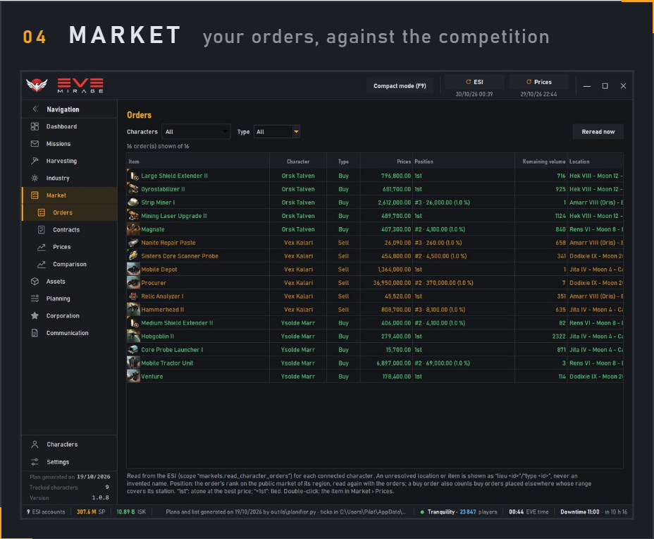 
Buy and sell orders in every station, your <strong>rank</strong> and the gap to the best price.</td>
</tr>
<tr>
<td width="50%" valign="top">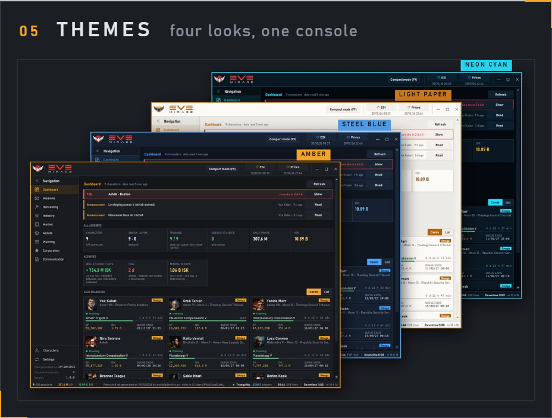 
Amber, Steel blue, Neon cyan and Light paper: switch at any time from the Theme menu.</td>
<td width="50%" valign="top">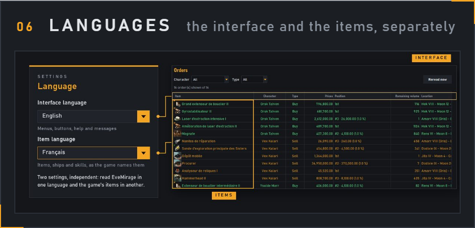 
Read EveMirage in one language and the game's items in another: <strong>two independent settings</strong>.</td>
</tr>
</table>

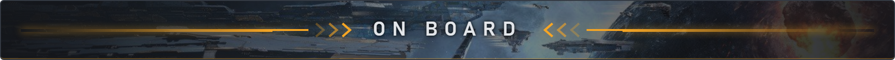

<table>
<tr>
<td width="50%" valign="top"><h3>Planning</h3>
<ul>
<li>Optimised skill plans, by goal and specialisation</li>
<li>Remaps: when, which, and what they save</li>
<li>Plan editor: levels, priorities, drag and drop, undo</li>
<li>Skill browser</li>
<li>Attribute optimiser, with 0, 1, 2… remaps</li>
<li>Skill books to buy and the route to buy them</li>
<li>EVEMon / EveLens import and export</li>
</ul></td>
<td width="50%" valign="top"><h3>Missions</h3>
<ul>
<li>PvE missions: variants, enemies, standing alerts</li>
<li>Remote agents and corporations</li>
<li>Standings and their history</li>
<li>Epic Arcs</li>
<li>“What next?”: the suggested follow-up</li>
</ul></td>
</tr>
<tr>
<td width="50%" valign="top"><h3>Harvesting</h3>
<ul>
<li>Mining: board, ledger, moons, refining</li>
<li>Planetary Interaction: colonies and extractors</li>
<li>Scout</li>
</ul></td>
<td width="50%" valign="top"><h3>Industry</h3>
<ul>
<li>Blueprints, running jobs</li>
<li>Manufacturing and research</li>
</ul></td>
</tr>
<tr>
<td width="50%" valign="top"><h3>Market & Assets</h3>
<ul>
<li>Orders, contracts, prices, comparator</li>
<li>Items, ships, fittings</li>
</ul></td>
<td width="50%" valign="top"><h3>Corporation</h3>
<ul>
<li>General page, activities, passages</li>
<li>Structures and their fuel</li>
<li>Killboard</li>
<li>Corporation announcements, forum and memos</li>
</ul></td>
</tr>
<tr>
<td width="50%" valign="top"><h3>Communication</h3>
<ul>
<li>EVE mail, read and written from EveMirage</li>
</ul></td>
<td width="50%" valign="top"><h3>Everyday</h3>
<ul>
<li>Four themes</li>
<li>Interface and item languages, chosen separately</li>
<li>Compact mode (F9), Windows notifications</li>
<li>Signed automatic updates</li>
<li>Official ESI login; your data stays on your PC</li>
</ul></td>
</tr>
</table>

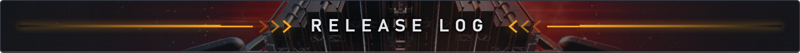

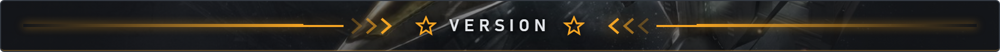

<strong>1.0.7</strong> — October 29, 2026

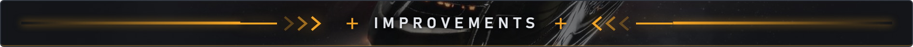

<ul>
<li>An information footer at the bottom: ESI accounts, SP and ISK.</li>
<li>Tranquility, the number of players online, EVE time and downtime are in the footer.</li>
<li>The top bar is lighter: the breadcrumb and compact mode move up into it, the page gains a row.</li>
<li>The logo has its new proportions.</li>
</ul>

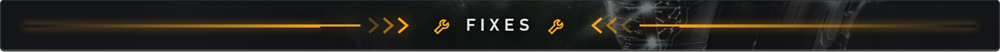

<ul>
<li>No more yellow strip at the bottom of the window.</li>
<li>“No tracked character” is shown on the dashboard, which opens the ESI accounts.</li>
</ul>

Previous versions

<strong>1.0.6</strong> — October 29, 2026

<strong>Improvements</strong>

<ul>
<li>The top bar is reorganised: no more menu bar.</li>
<li>ESI and Prices have their button at the top right, with the date of their last read.</li>
<li>Tranquility and the number of players online, EVE time and the time until downtime are in the bar.</li>
<li>Theme, folders, About and Quit are in Settings; Projects is in Planning, Characters in the ESI accounts.</li>
<li>The logo in the bar follows the theme.</li>
<li>The Missions page gives the date the missions and agents were surveyed.</li>
<li>The exe no longer changes between versions: after this one, the antivirus stops re-examining it at every update, and startup is a little faster.</li>
</ul>

<strong>1.0.5</strong> — October 29, 2026

<strong>Fixes</strong>

<ul>
<li>Updates are now offered in a window in the middle of EveMirage, with what the version changes.</li>
<li>After an update, the installer no longer starts EveMirage twice.</li>
<li>The Myrmoon logo on the installer no longer touches the corner.</li>
</ul>

<strong>1.0.4</strong> — October 29, 2026

<strong>Fixes</strong>

<ul>
<li>The EveMirage logo now shows reliably at startup.</li>
<li>The installer no longer starts EveMirage twice when you click Finish.</li>
<li>The Skills badge shows the date of the last ESI reading instead of “unknown”.</li>
<li>Offline messages in Orders, Contracts and Industry jobs are now in English.</li>
<li>The installer and uninstaller carry the Myrmoon logo.</li>
</ul>

<strong>1.0.3</strong> — October 29, 2026

<strong>Fixes</strong>

<ul>
<li>Automatic updates now come from the new release repository.</li>
</ul>

<strong>1.0.2</strong> — October 29, 2026

<strong>Fixes</strong>

<ul>
<li>Page titles are now translated: Orders, Contracts, Industry jobs, Remote agents.</li>
<li>“Announcement” is no longer cut off on the dashboard.</li>
</ul>

<strong>1.0.1</strong> — October 28, 2026 · first public release

<strong>Improvements</strong>

<ul>
<li><strong>Automatic update</strong>: EveMirage offers the next version and installs it, signature checked.</li>
<li>Installs for your Windows account only, no administrator rights.</li>
<li>Corporation service: general page, structure fuel, in-game events.</li>
</ul>

<strong>Fixes</strong>

<ul>
<li>Queue checkboxes stayed ticked after switching character.</li>
<li>The FUEL line was wrongly shown in red.</li>
<li>An event link only opens if it starts with <code>https://</code>.</li>
</ul>

<strong>1.0</strong> — October 27, 2026 · shared with the first testers, without automatic update.

<table>
<tr>
<td width="33%" valign="top"><h3>Install</h3>Download the <a href="https://github.com/myrmoon/evemirage-releases/releases/latest/download/EveMirage-Setup.exe">installer</a>, run it, then connect a character. Windows 10 or 11.</td>
<td width="33%" valign="top"><h3>Your data</h3>Everything stays on your PC. Login goes through CCP's official site; EveMirage never sees your password.</td>
<td width="33%" valign="top"><h3>A problem?</h3>Open an <a href="https://github.com/myrmoon/evemirage-releases/issues">issue</a> on this repository.</td>
</tr>
</table>

This material is used with limited permission of CCP Games. No official affiliation or endorsement by CCP Games is stated or implied. © 2014 CCP hf. All rights reserved. "EVE", "EVE Online", "CCP", and all related logos and images are trademarks or registered trademarks of CCP hf.

