
<b>English</b> · <a href="README.fr.md">Français</a>

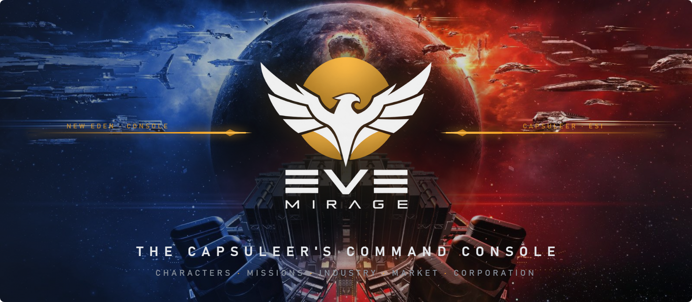

&nbsp;

EveMirage gathers what an EVE Online pilot needs every day: skill plans for all your characters, missions, mining, industry, the market and your corporation's life. One window, connected to ESI, that keeps everything on your PC.

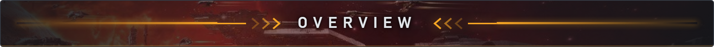

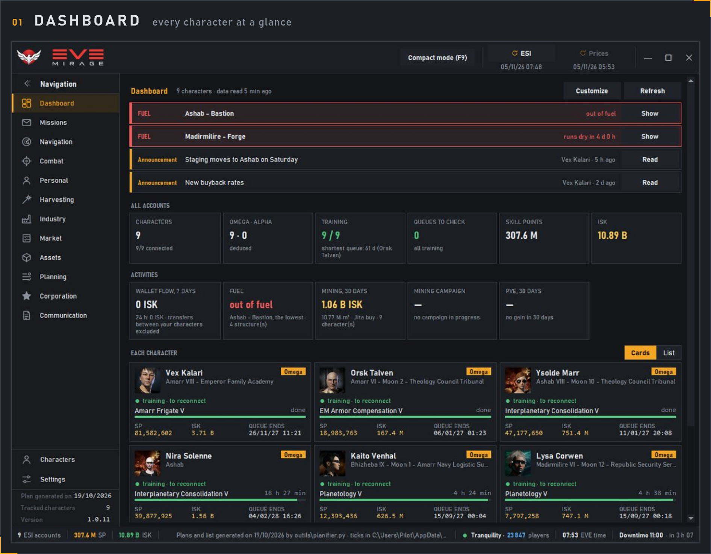

Training in progress, queue end, skill points, ISK, Omega status, fuel and corporation announcements, for <strong>all your characters</strong> at once.

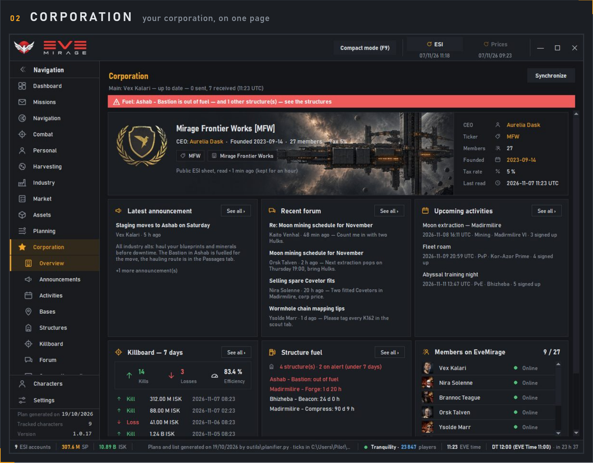

Members online, announcements, forum, upcoming activities and the <strong>killboard</strong>, shared through the corporation service.

<table>
<tr>
<td width="50%" valign="top">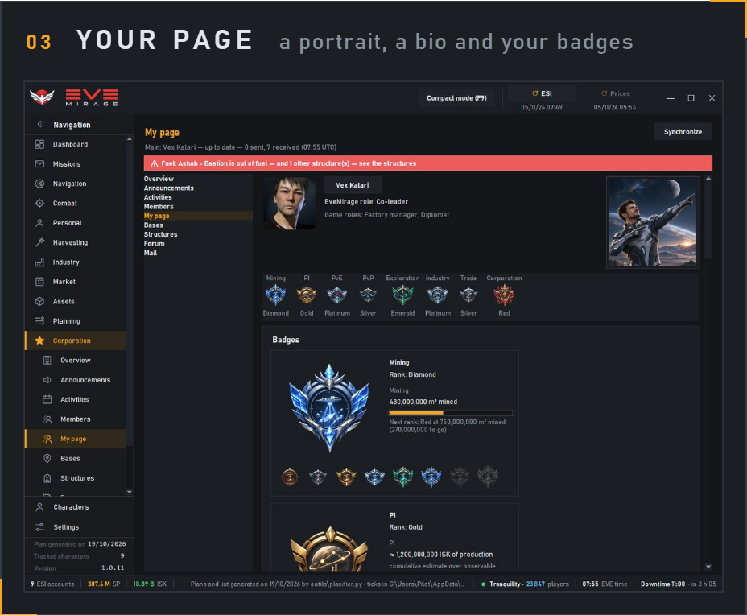 
Each member has a page: portrait, game roles, a few words about themselves and eight <strong>badges</strong>, from Bronze to Violet, earned by mining, planetary interaction, PvE, PvP, exploration, industry, trade and life in the corporation.</td>
<td width="50%" valign="top">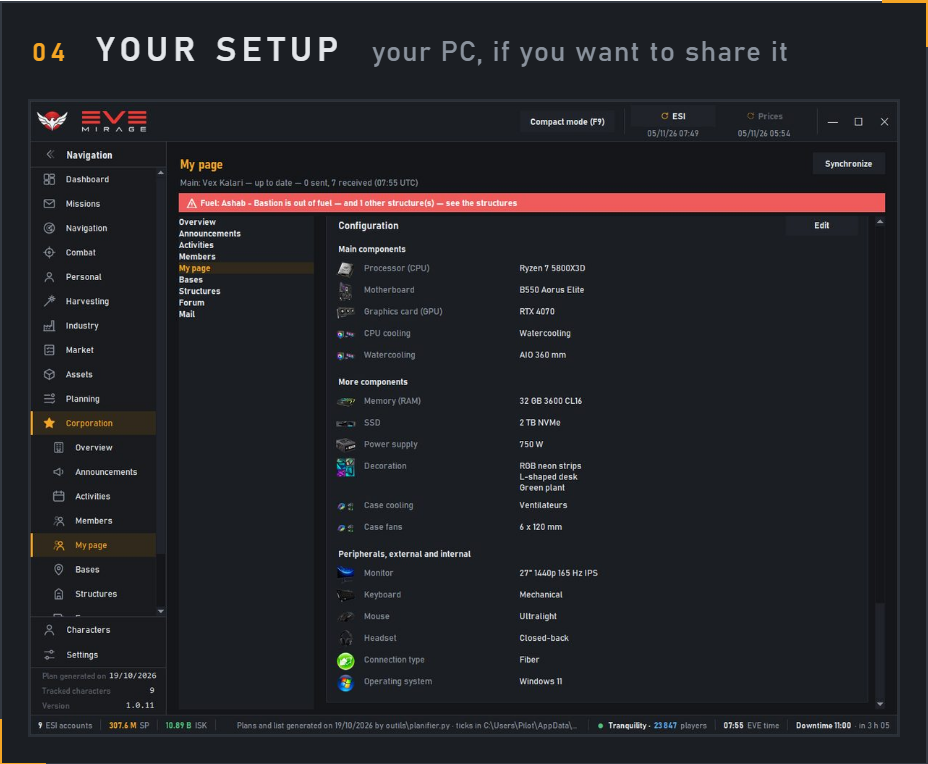 
Fill in the community's form (processor, graphics card, screen, peripherals…) and your corporation mates see your <strong>setup</strong> on your page. You choose what to share.</td>
</tr>
<tr>
<td width="50%" valign="top">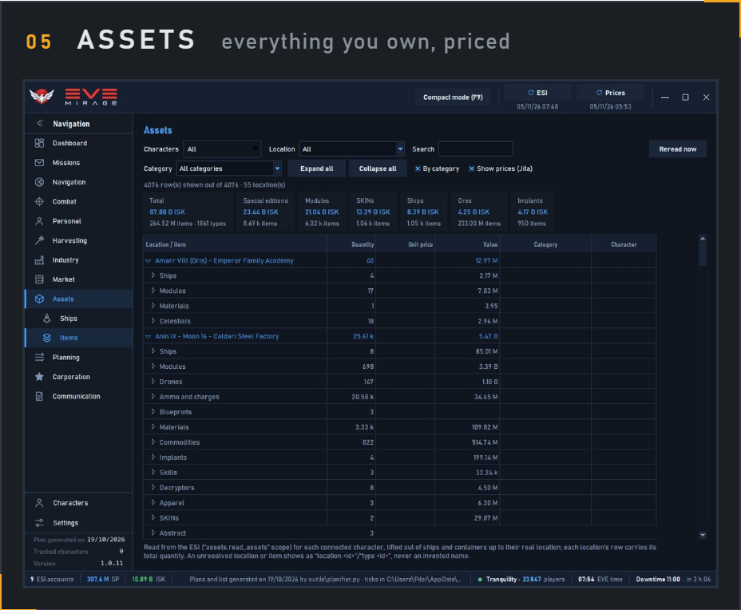 
By location and category, at Jita prices, for one, several or all characters.</td>
<td width="50%" valign="top">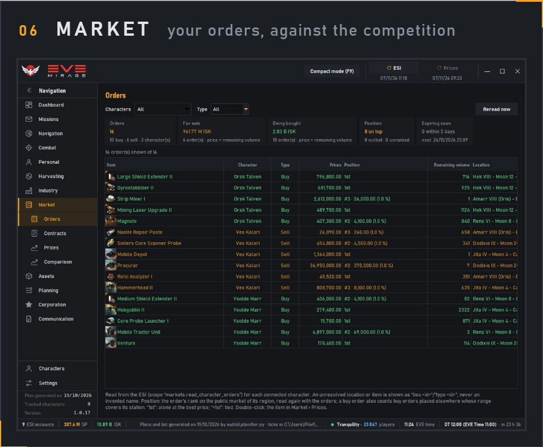 
Buy and sell orders in every station, your <strong>rank</strong> and the gap to the best price.</td>
</tr>
<tr>
<td width="50%" valign="top">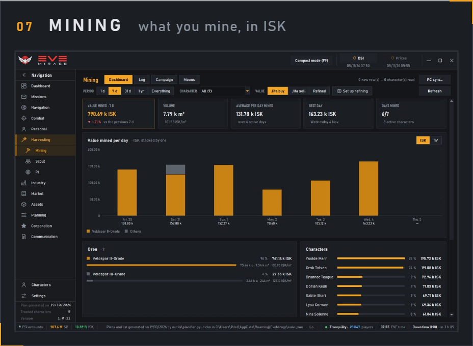 
Value mined per day, by ore and by character, priced at Jita buy, Jita sell or refined, with the log, campaigns and moons one tab away.</td>
<td width="50%" valign="top">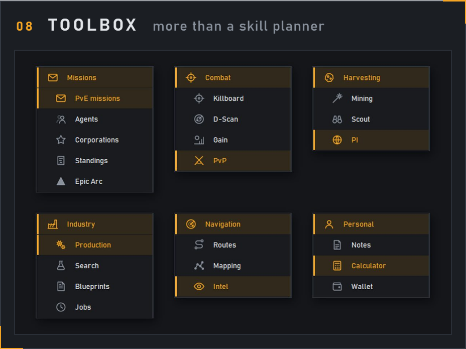 
A multi-tool for the whole game: <strong>D-Scan, killboard, Scout, planetary interaction, routes and mapping, Intel, industry jobs, standings, Epic Arcs, notes, calculator and wallet</strong>. All of it is listed below.</td>
</tr>
<tr>
<td width="50%" valign="top">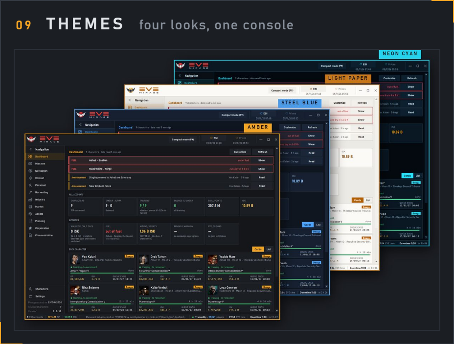 
Amber, Steel blue, Neon cyan and Light paper: switch at any time from the Theme menu.</td>
<td width="50%" valign="top">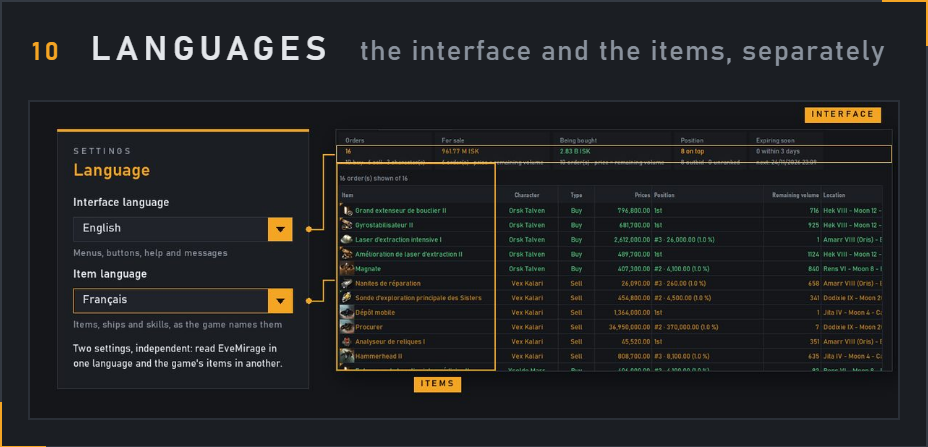 
Read EveMirage in one language and the game's items in another: <strong>two independent settings</strong>.</td>
</tr>
</table>

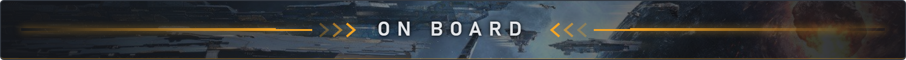

<table>
<tr>
<td width="50%" valign="top"><h3>Planning</h3>
<ul>
<li>Optimised skill plans, by goal and specialisation</li>
<li>Remaps: when, which, and what they save</li>
<li>Plan editor: levels, priorities, drag and drop, undo</li>
<li>Skill browser</li>
<li>Attribute optimiser, with 0, 1, 2… remaps</li>
<li>Skill books to buy and the route to buy them</li>
<li>EVEMon / EveLens import and export</li>
</ul></td>
<td width="50%" valign="top"><h3>Missions</h3>
<ul>
<li>PvE missions: variants, enemies, standing alerts</li>
<li>Remote agents and corporations</li>
<li>Standings and their history</li>
<li>Epic Arcs</li>
<li>“What next?”: the suggested follow-up</li>
</ul></td>
</tr>
<tr>
<td width="50%" valign="top"><h3>Harvesting</h3>
<ul>
<li>Mining: board, ledger, moons, refining</li>
<li>Planetary Interaction: colonies and extractors</li>
<li>Scout</li>
</ul></td>
<td width="50%" valign="top"><h3>Industry</h3>
<ul>
<li>Blueprints, running jobs</li>
<li>Manufacturing and research</li>
</ul></td>
</tr>
<tr>
<td width="50%" valign="top"><h3>Market & Assets</h3>
<ul>
<li>Orders, contracts, prices, comparator</li>
<li>Items, ships, fittings</li>
</ul></td>
<td width="50%" valign="top"><h3>Corporation</h3>
<ul>
<li>General page, activities, passages</li>
<li>Structures and their fuel</li>
<li>Killboard</li>
<li>Corporation announcements, forum and memos</li>
</ul></td>
</tr>
<tr>
<td width="50%" valign="top"><h3>Communication & tools</h3>
<ul>
<li>EVE mail, read and written from EveMirage</li>
<li>D-Scan, routes, mapping, Intel</li>
<li>Notes, calculator, wallet</li>
</ul></td>
<td width="50%" valign="top"><h3>Everyday</h3>
<ul>
<li>Four themes</li>
<li>Interface and item languages, chosen separately</li>
<li>Compact mode (F9), Windows notifications</li>
<li>Signed automatic updates</li>
<li>Official ESI login; your data stays on your PC</li>
</ul></td>
</tr>
</table>

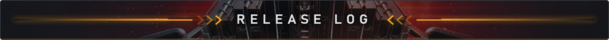

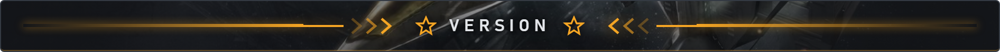

<strong>1.1.6</strong> — November 10, 2026

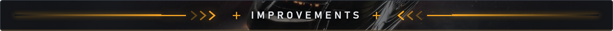

<ul>
<li>Corporation journal: every arrival and departure in the corporation is recorded, whether the member uses EveMirage or not</li>
<li>A new member appears on their real corporation join date</li>
<li>New read-only ESI permission (member list): a window offers to reconnect your characters at first launch</li>
</ul>

The last 5 previous versions

<strong>1.1.5</strong> — November 10, 2026

<ul>
<li>Corporation journal: a card under the killboard on Corporation › General (new members, departures, co-leaders, awarded badges) and a searchable history</li>
<li>13 honorary distinctions, awarded by the corporation leader or a co-leader</li>
<li>30 corporation tenure badges</li>
<li>Member page redesigned: portrait, characters, badges</li>
<li>Character logout: the security copy of the tokens is deleted at the next launch</li>
</ul>

<strong>1.1.4</strong> — November 9, 2026

<ul>
<li>**PC sync**: your wallet, reputations and mining from all your PCs come together through a Google Drive, OneDrive or Dropbox folder, set up in one click in Settings; your tokens never travel.</li>
<li>**Dashboard**: the activity period also offers 1 year, and the Standings card gathers every standing from all your characters with the net total, rises in green and drops in red.</li>
<li>**Visual improvements** on the dashboard.</li>
<li>**Security**: the update is checked more strictly before it runs, and sync, Discord webhooks, the forum and the error log are hardened.</li>
<li>**Missions**: the "Illegal activity" sheet states the real standing loss, and the compact list now reads in full.</li>
<li>**Performance**: screens open faster (Industry › Blueprints in particular) and switching themes is much quicker.</li>
</ul>

<strong>1.1.3b</strong> — November 8, 2026

<ul>
<li>Larger, clearer Ω / α badge on character cards</li>
<li>The left menu scrolls when a group opens in a short window: no more cut-off entries</li>
</ul>

<strong>1.1.3</strong> — November 8, 2026

<ul>
<li>Standings as a market-style table: your favourite factions and corporations that moved, with their change over 24 h, 3 d, 7 d or 1 m</li>
<li>Clearer accelerators and character cards (Ω and α)</li>
<li>Faster launch, prices refreshed in the background with their progress next to the Price button</li>
<li>Pick a character without following it, "Restart" from the notification area, smoother typing in PvE Missions</li>
</ul>

<strong>1.1.2</strong> — November 8, 2026

<ul>
<li>Dashboard: 1 d / 7 d / 30 d period selector for all activities (remembered between launches)</li>
<li>Dashboard: new Standings card, rises and falls like a stock ticker</li>
<li>Prices refresh in the background at launch, with an indicator at the bottom of the window</li>
<li>Faster launch and dashboard</li>
<li>Favorite corporations: standings values show as soon as the page opens, with no wait</li>
</ul>

<table>
<tr>
<td width="33%" valign="top"><h3>Install</h3>Download the <a href="https://github.com/myrmoon/evemirage-releases/releases/latest/download/EveMirage-Setup.exe">installer</a>, run it, then connect a character. Windows 10 or 11.</td>
<td width="33%" valign="top"><h3>Your data</h3>Everything stays on your PC. Login goes through CCP's official site; EveMirage never sees your password.</td>
<td width="33%" valign="top"><h3>A problem?</h3>Open an <a href="https://github.com/myrmoon/evemirage-releases/issues">issue</a> on this repository.</td>
</tr>
</table>

This material is used with limited permission of CCP Games. No official affiliation or endorsement by CCP Games is stated or implied. © 2014 CCP hf. All rights reserved. "EVE", "EVE Online", "CCP", and all related logos and images are trademarks or registered trademarks of CCP hf.

